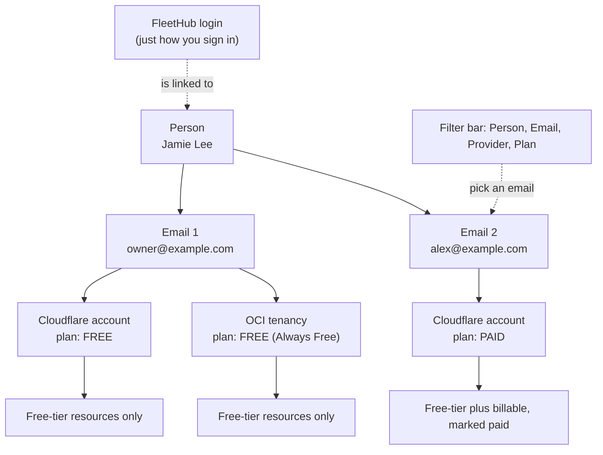

# Person, email, account: the identity hierarchy (design, 2026-10-30)

Status: steps 1 to 3 and 5 built 2026-10-31 to 2026-11-02 (schema, email dropdown, filter bar and server filters, plan detection and billing flag); step 4 (collapsible person and email tree with roll-up lines, in the Tiers view) built 2026-11-05. Requested by the owner after looking at the Identities and Accounts view.

## The problem

The view groups accounts under the identity that is signed in. The owner has one FleetHub login but several emails, and several of those emails have an account at the same provider (for example a personal and a work Cloudflare account). Today there is no level between "person" and "account", so the owner cannot answer "what does this email own?", cannot filter by email, and cannot tell a free account from a paid one.

## Diagram (confirmed by the owner 2026-10-31; use as the reference)



Assumptions confirmed: an email belongs to one person; every account sits under exactly one email.

## Model: four tiers, three already exist

```
Person (identities)                     Jamie Lee
 └─ Email (identity_contacts, kind=email)   owner@example.com, alex@example.com, ...
     └─ Provider account (provider_accounts)  Cloudflare "personal", OCI "mumbai-1"
         ├─ Plan: free | paid | unknown    ← new
         └─ Resources (resources)           each tagged free-tier or billable
```

- The signed-in FleetHub user is only a login. It links to a person (it is not the root of the tree). Several logins can map to one person later.
- Person and email already exist as `identities` and `identity_contacts`. The missing piece is that an account points at a person only; its email is a free-text `owner_email`. Fix: add `provider_accounts.contact_id` (references `identity_contacts`), set from the owner email at migration time (match on email, else create the contact under the account's identity), and keep `owner_email` as a derived copy so existing code keeps working.
- "Belongs to" in the upload form and Account settings stays a person picker, and gains a second dropdown, "Email", listing that person's emails (+ add email). One new concept in the UI, no new free text.

## Free versus paid

- New column `provider_accounts.plan` (`free`, `paid`, `unknown`) and `plan_source` (`detected`, `manual`).
- Detected where the provider says so: Cloudflare account plan, OCI tenancy "Always Free" versus a paid or trial subscription, Supabase and Neon organization plan, Upstash database plan. Undetectable means `unknown`, and the owner sets it in Account settings (one dropdown, behind the existing disclosure).
- Resources get `billing` (`free_tier`, `billable`, `unknown`), derived from account plan plus the allowance catalog (`limits store`, docs/46). On a free account only free-tier resources are shown and counted; on a paid account billable ones appear too, with a "paid" badge. A toggle, "Show paid resources", defaults to on for paid accounts and is hidden for free ones.

## The view

1. A filter bar above every Fleet view (Resources, Fleet Map, Identities and Accounts): **Person**, **Email**, **Provider**, **Plan** (All, Free, Paid). Persisted in the URL, so a filtered view can be bookmarked.
2. Identities and Accounts becomes a tree you can collapse: Person, then Email, then Provider account (plan chip, health, expiry), then resources. Selecting an email node filters the other panels to it.
3. Email nodes show the roll-up: accounts per provider, free allowance used, anything expiring.
4. Fleet Map reuses the same filter instead of its own scope.

## API

`GET /api/identities` returns `contacts[].accounts[]` (accounts nested under their email) plus `unassigned` for accounts with no email contact. `GET /api/inventory` accepts `person`, `email`, `provider`, `plan` filters. Agents get the same filters, so an LLM can ask "free capacity on alex@example.com".

## Build order (each step shippable alone)

1. Schema and migration: `contact_id`, `plan`, `plan_source`; backfill from `owner_email`. Tests on a disposable DB.
2. Email dropdown in the upload form and Account settings; duplicate detection then also works per email.
3. Filter bar and server-side filters (person, email, provider).
4. Tree view in Identities and Accounts, with the email roll-up.
5. Plan detection per provider, manual override, free/paid resource filtering.

## Decisions taken (change if wrong)

- Plan is a property of the account, not of the email: one email can hold a free Cloudflare and a paid one.
- Emails are never identities. A person has many emails; an account has exactly one.
- An account whose email is not under any person is shown under "Unassigned" with a one-click "Assign", not hidden.
